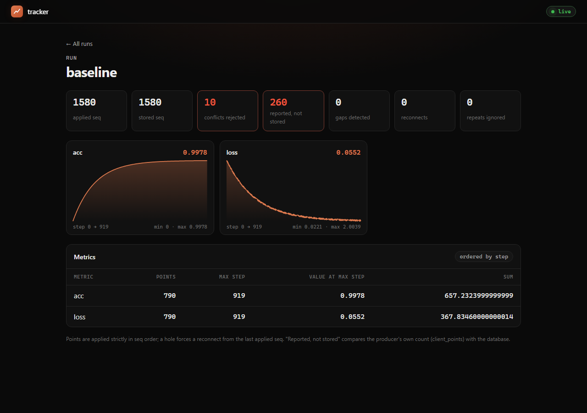

# Mini experiment tracker

Projects with API keys, metric ingestion over an unreliable network, a run list and a live run page (SSE).
Read [NOTE.md](NOTE.md) first (results and verdict), then [DESIGN.md](DESIGN.md) (before code),
[CHANGES.md](CHANGES.md) (after), [STRESS.md](STRESS.md), [PERF.md](PERF.md). Per-phase server timings: `GET /api/admin/timings` (admin token, per worker);
`./load/perf_step.ps1 <name> [--jitter]` runs the 50×10 load twice with them.



## Run
```bash
docker compose up --build
```
- App: http://localhost:8000 (page asks for an API key)
- Postgres: localhost:55432 (owner/owner, used by tests as ground truth)
- toxiproxy: control API on 8474, proxies on 18000 (viewers) and 18001 (producers)

Create a project and key (admin token defaults to `dev-admin-token`):
```bash
curl -X POST localhost:8000/api/admin/projects -H "x-admin-token: dev-admin-token" -H "content-type: application/json" -d "{\"name\":\"demo\"}"
```

## API
| Method | Path | Notes |
|---|---|---|
| POST | /api/admin/projects | admin token; returns `project_id`, `api_key` (shown once) |
| POST | /api/keys/rotate | new key, caller's key revoked immediately |
| POST / GET | /api/runs | create / list own runs |
| GET | /api/runs/{id} | 404 for foreign and missing alike |
| POST | /api/runs/{id}/metrics | `{"batch_id": uuid, "events": [{"key","step","value","ts?"}], "client_points?": n}`, ≤1000, idempotent |
| GET | /api/runs/{id}/metrics?after=&limit= | history by seq |
| GET | /api/runs/{id}/conflicts | values rejected by first-write-wins, with the stored value |
| GET | /api/runs/{id}/stream | SSE, `id: seq`, resume with `Last-Event-ID` |
| GET | /api/admin/missing-points?quiet_seconds=60 | admin; runs whose producer reported more points (`client_points` in batches) than are stored |

## Tests (stack must be running)
```bash
python -m venv .venv && .venv/Scripts/pip install -r tests/requirements.txt && .venv/Scripts/python -m playwright install chromium
.venv/Scripts/python -m pytest -s -v
.venv/Scripts/python scripts/mutation_check.py      # rebuilds the api container several times
```
Round-2 stress tests (partition test needs chaos mode, where the API reaches Postgres through toxiproxy) and round-3
noisy-neighbour attacks (`load/r3_series.ps1`): see [STRESS.md](STRESS.md#how-to-run).
Per-process limits are env vars: `PROJECT_RPS`, `PROJECT_BURST`, `PROJECT_BYTES_PS`, `PROJECT_BYTES_BURST`,
`REJECT_DELAY`, `RUN_QUEUE_MAX`, `DB_POOL_MAX`.

Load test, run inside the compose network (PowerShell wrapper; the docstring has the plain docker command):
```bash
./load/run_in_network.ps1 loadtest.py --runs 50 --rate 10 --duration 60
```

## Layout
`api/app` service and page · `db/init.sql` schema, roles, RLS · `tests/` e2e, isolation, silent failures, property ·
`load/` load test and diagnostics · `scripts/` smoke and mutation check · `results/` raw outputs including red runs.
